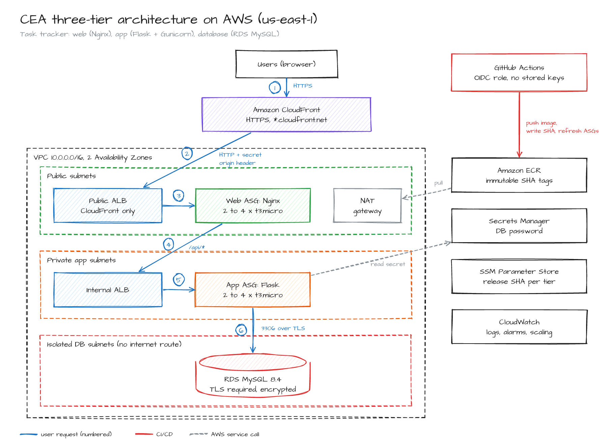

# CEA: Three-Tier Web Application on AWS

Cloud Computing (SE-490) Complex Engineering Activity. A task-tracker web app deployed as three tiers on AWS:

| Tier | Technology | AWS placement |
|---|---|---|
| Web | Nginx container (static UI + reverse proxy) | EC2 Auto Scaling Group in public subnets, behind an internet-facing ALB that only CloudFront can reach |
| Application | Flask + Gunicorn container (REST API) | EC2 Auto Scaling Group in private subnets, behind an internal ALB |
| Database | MySQL 8.4 | Amazon RDS in isolated private subnets, TLS required, encrypted at rest |

Users reach the app over HTTPS through Amazon CloudFront. Images live in Amazon ECR with immutable git SHA tags. GitHub Actions tests, builds, pushes and deploys on every push to `main`. It signs in to AWS with GitHub OIDC (no stored AWS keys) and rolls back on its own if the smoke test fails. Terraform creates all infrastructure. CloudWatch collects container logs and drives auto scaling.



## Repository layout

```
app/                     Application tier (Flask API, Dockerfile, pytest tests)
web/                     Web tier (Nginx config template, static UI, Dockerfile)
docker-compose.yml       Local run of all three tiers (web, app, MySQL)
tests/e2e/               End-to-end tests through Nginx (web -> app -> MySQL)
loadtest/                k6 load test that drives auto scaling
scripts/                 Segmentation check, CI rollout and smoke test scripts
.github/workflows/       CI/CD pipeline (deploy.yml)
infra/terraform/         Infrastructure as code (VPC, SGs, ALBs, ASGs, RDS, ECR, CloudFront, OIDC, Secrets Manager, CloudWatch)
docs/                    Deployment guide and diagrams
```

## Run locally

```bash
cp .env.example .env
docker compose up --build
# open http://localhost:8080
pytest app/tests
E2E_BASE_URL=http://localhost:8080 pytest tests/e2e
```

## Deploy to AWS

See [docs/AWS_DEPLOYMENT_GUIDE.md](docs/AWS_DEPLOYMENT_GUIDE.md). Short version:

```bash
cd infra/terraform
cp terraform.tfvars.example terraform.tfvars      # set github_repo = "<owner>/<repo>"
terraform init
terraform apply -target=aws_ecr_repository.web -target=aws_ecr_repository.app \
  -target=aws_ssm_parameter.image_tag -target=aws_iam_openid_connect_provider.github \
  -target=aws_iam_role.github_deploy -target=aws_iam_role_policy.github_deploy
# set the GitHub variable AWS_DEPLOY_ROLE_ARN, push to main (the pipeline pushes the images)
terraform apply
terraform output app_url                          # https://<id>.cloudfront.net
```

Tear down with `terraform destroy` when finished.

## API

| Method | Path | Purpose |
|---|---|---|
| GET | `/healthz` | web tier health (ALB check) |
| GET | `/web-info` | which web instance answered |
| GET | `/api/health` | app tier liveness (ALB check) |
| GET | `/api/health/db` | database connectivity and TLS cipher |
| GET | `/api/info` | app instance, AZ, release version |
| GET/POST | `/api/tasks` | list / create tasks |
| PATCH/DELETE | `/api/tasks/<id>` | update / delete a task |
